# SiteForge AI

> Describe the website you want in plain language. SiteForge AI designs it, writes the code, installs the dependencies and runs a live preview, all inside the browser with no local setup.

---

## Table of Contents

- [Problem](#problem)
- [Solution](#solution)
- [Features](#features)
- [Architecture](#architecture)
- [Data Flow](#data-flow)
- [Tech Stack](#tech-stack)
- [Getting Started](#getting-started)
- [Example Usage](#example-usage)
- [Product Layer](#product-layer)
- [Design Decisions](#design-decisions)
- [KPI Plan](#kpi-plan)
- [Limitations & Future Work](#limitations--future-work)
- [Access Control](#access-control)
- [Live Deployment](#live-deployment)
- [Screenshots](#screenshots)
- [Design System](#design-system)
- [Demo Walkthrough](#demo-walkthrough)
- [Acknowledgements & License](#acknowledgements--license)

---

## Problem

Small businesses, freelancers and students need a working website, but the options are poor. Template builders produce generic pages and still need hours of manual editing. Hiring a developer costs money and takes days. General-purpose chatbots output code that the user then has to copy, install, debug and host by hand, so non-developers get stuck at the first error.

## Solution

SiteForge AI closes that loop. The user describes a site ("a modern landing page for a dental clinic with services, doctors, testimonials and an appointment CTA"). The model replies with a structured plan of files and shell commands. The app executes that plan in an in-browser Node.js runtime (WebContainers), starts a dev server and shows the running site in a live preview. The user keeps chatting to refine it ("make the hero more premium", "add an FAQ section"), inspects the generated source in a code editor, and downloads the finished project as a zip.

## Features

- **Natural-language site generation** with example prompt chips (restaurant, SaaS landing page, dental clinic, portfolio, ecommerce, real estate).
- **Prompt enhancer:** one click rewrites a rough prompt into a more specific one before it is sent.
- **Live preview** in desktop, tablet and mobile viewports.
- **Code mode:** file tree, CodeMirror editor and an integrated terminal. User edits are sent back to the model as diffs with the next message, so refinements build on the latest code.
- **Iterative refinement** in the same chat; the preview updates in place.
- **Chat history** saved in the browser (IndexedDB); click the project name in the header to rename it.
- **Zip export** of the generated project.
- **Friendly failure states:** a readable message if the in-browser runtime cannot start, instead of a hung screen.
- **Mobile-friendly layout** with a bottom tab bar (AI, Preview, Code).

## Architecture

The app is a Remix application deployed on Vercel. The browser does the heavy lifting: it runs the generated project. The server's only job is to stream the model's response.

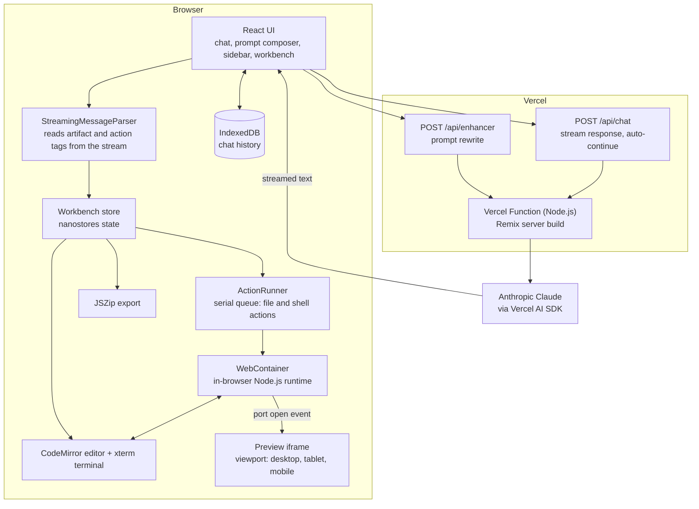

## Data Flow

From one prompt to a running site:

```mermaid
sequenceDiagram
  autonumber
  actor U as User
  participant UI as Chat UI
  participant API as /api/chat (Vercel Function)
  participant LLM as Claude
  participant P as Message parser
  participant AR as ActionRunner
  participant WC as WebContainer
  participant PV as Preview

  U->>UI: Describe the website
  UI->>API: POST messages
  API->>LLM: System prompt + messages (streaming)
  loop Streamed tokens
    LLM-->>UI: Text chunk
    UI->>P: Parse chunk
    P-->>AR: Action: write file / run shell command
  end
  AR->>WC: Write files, then npm install, then dev server
  WC-->>PV: Dev server port opens, URL provided
  PV-->>U: Live site
  Note over API,LLM: If the model stops at the token limit, the server<br/>asks it to continue (up to 2 segments)
  U->>UI: "Make the hero more premium"
  UI->>API: Messages + diffs of any manual edits
  Note over UI,WC: Same loop; the model rewrites the files that change
```

How an action moves through the runner (`app/lib/runtime/action-runner.ts`):

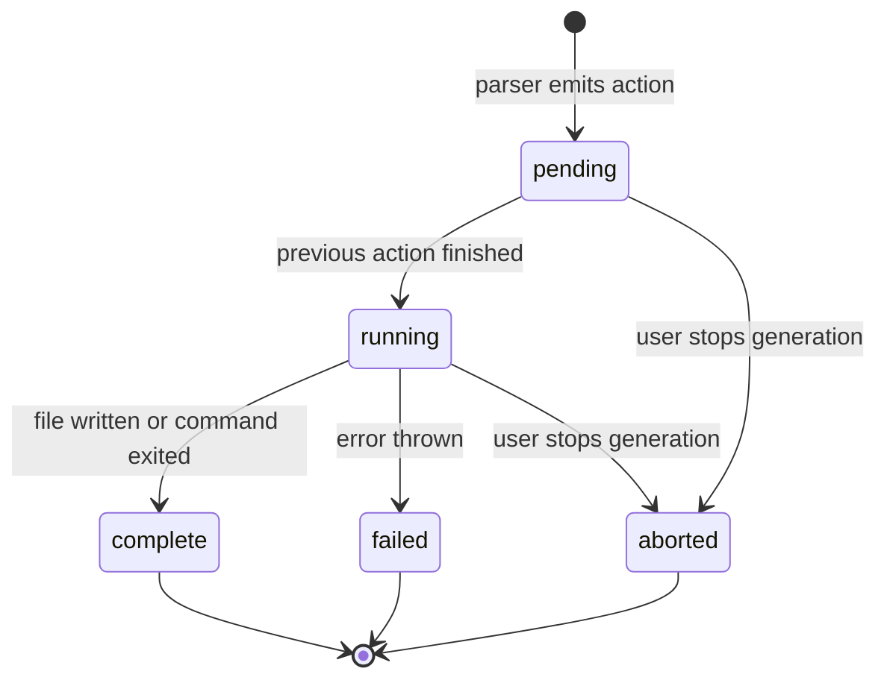

Actions run strictly one after another, because the order matters: dependencies must be installed before the dev server starts, and files must exist before they are run.

## Tech Stack

| Layer | Technology |
|---|---|
| Framework | Remix 2 (React 18), Vite 5, TypeScript |
| Hosting | Vercel (Remix Vite preset, Node.js Functions) |
| AI | Anthropic Claude through the Vercel AI SDK (`ai`, `@ai-sdk/anthropic`) |
| In-browser runtime | `@webcontainer/api` |
| Editor and terminal | CodeMirror 6, xterm.js |
| State | nanostores |
| Styling | UnoCSS, SCSS |
| Persistence | IndexedDB (browser) |
| Export | JSZip |
| Testing and quality | Vitest, ESLint, Prettier, TypeScript, Husky |

## Getting Started

**Prerequisites:** Node.js 20 (see `.tool-versions`), pnpm 9, an Anthropic API key, and (for hosting) a Vercel account.

```bash
git clone https://github.com/divyanshi-sachan/SiteForge_AI.git
cd SiteForge_AI
git switch vercel-deploy
pnpm install
```

### Deploy to Vercel

```bash
npm i -g vercel          # Vercel CLI
vercel login             # opens your browser to sign in
vercel link              # create / link the Vercel project
vercel env add ANTHROPIC_API_KEY production   # paste your key when prompted
vercel --prod            # build and deploy
```

The app is a Remix project, so Vercel builds it with the Remix Vite preset (`@vercel/remix`). Two settings matter:

- `/api/chat` runs as a Node.js Function with `maxDuration = 300` seconds, because a generation streams for a minute or more. If your Vercel plan limits Function duration below that, lower the value in `app/routes/api.chat.ts`.
- The HTML response sets `Cross-Origin-Embedder-Policy: require-corp` and `Cross-Origin-Opener-Policy: same-origin` (in `app/entry.server.tsx`). The in-browser runtime (WebContainers) needs them.

> **Cost and abuse warning.** The deployed `/api/chat` endpoint has no login or rate limit, so anyone with the URL can spend your Anthropic credit. Set a spending limit on the API key, and consider Vercel's password protection or a firewall rule before sharing the link.

### Run locally

`vercel dev` runs the app with the same runtime as production (it needs `vercel login` and `vercel link` first). `pnpm dev` (the plain Vite dev server) currently does not work; see [Limitations](#limitations--future-work).

| Command | What it does |
|---|---|
| `pnpm build` | Production build (Remix Vite preset) |
| `pnpm deploy` | Deploy to production with the Vercel CLI |
| `pnpm test` | Unit tests (Vitest) |
| `pnpm typecheck` / `pnpm lint` | Type checking and linting |

**Model:** the model identifier is set in `app/lib/.server/llm/model.ts` (`claude-sonnet-5-5`). It must be a model your key can use.

## Example Usage

1. Open the app and pick an example chip, or type:

   *"Create a modern landing page for a dental clinic with services, doctors, testimonials and an appointment CTA."*
2. Optionally click **Enhance prompt** to let the model make it more specific.
3. Watch the files appear and the install and dev-server steps run; the live preview opens when the server is ready.
4. Refine in the same chat: *"Make the hero more premium"*, *"Add an FAQ section"*.
5. Switch to **Code** to read or edit any generated file, then **Download** the project as a zip.

Tips for better results: name the business type, the pages you want and the style.

## Product Layer

The parts of this repository that make it a product, beyond the generation engine:

| Area | What was built |
|---|---|
| Branding | A single `BRAND` config (`app/utils/brand.ts`) drives the name, tagline, prompts and metadata, so the product can be re-labelled in one place |
| Onboarding | New-project screen, prompt composer and example prompt chips |
| Navigation | Project sidebar with history, and a mobile tab bar |
| Preview | Desktop, tablet and mobile viewport switcher; preview is the default view |
| Reliability | A friendly message when the in-browser runtime fails to boot; a reusable error state; a generation status indicator |
| History | Rename for saved chats (`updateChatDescription`) |
| Export | One-click zip download of the generated project (`downloadProject.ts`) |

## Design Decisions

| Decision | Why | Tradeoff |
|---|---|---|
| Run the generated project in the browser (WebContainers) | No per-user server sandbox to build, secure or pay for; previews start instantly and scale with the number of users' browsers | Limited to what WebContainers support: no native binaries, no `pip`, no `git` |
| Model returns a structured plan (files + shell commands) instead of prose code | The app can execute the result and show a working site; a parser can turn streaming text into actions as it arrives | Depends on the model following the format exactly |
| Actions run in a strict serial queue | File writes, installs and dev-server start are order-dependent | Slower than parallel execution |
| Stream the response and auto-continue at the token limit | Whole sites do not fit in one response; the server re-prompts the model to continue, up to 2 segments | Output is capped at about 2 × 8,192 tokens |
| Keep the server thin (stream only) | One stateless endpoint is cheap to run on Vercel and easy to scale | No server-side history, accounts or quotas |
| Persist chats in IndexedDB | No backend or login needed | History is per browser and lost if site data is cleared |
| Send manual code edits back as diffs | The model refines the latest code and does not overwrite the user's changes | Larger prompts as edits accumulate |
| One `BRAND` config | White-labelling without hunting for strings | None significant |

## KPI Plan

No usage or quality numbers have been measured yet. This is the plan for collecting them.

**Business problem:** get a non-developer from an idea to a working website quickly and cheaply.

| KPI | Definition | How to measure | Starting target to validate |
|---|---|---|---|
| Time to first preview | Prompt submitted → preview iframe shows the running site | Timestamp on submit and on the WebContainer `port` event | Median under 60 s |
| First-attempt success rate | Share of prompts where the site boots with no failed action and no manual fix | Count `failed` actions per prompt on a fixed prompt set | At least 80 % |
| Iterations to acceptable | Follow-up messages before the user stops refining or downloads | Messages per project, plus a thumbs-up on download | 3 or fewer |
| Export rate | Share of projects that are downloaded | Count of zip downloads over projects | Track; no target yet |
| Cost per site | Tokens × price for one generation plus refinements | Token usage reported by the API per project | Under a fixed budget per site |
| Failure causes | Breakdown of failed runs (install error, model format error, runtime boot error) | Log the error category on each failure | Used to prioritise fixes |

**Method:** build a fixed set of 20 representative prompts (restaurant, clinic, portfolio, SaaS, shop and so on), run each three times, and record the KPIs above per run. Report medians and the failure breakdown, not just averages. Repeat after every change to the system prompt or the model, so quality changes are visible.

## Limitations & Future Work

### What does not work yet

- `pnpm dev` **does not work.** In the Vite dev server the Node polyfill is applied to the build only, so the browser crashes on `node:buffer` and the page never becomes interactive; enabling it in dev makes the server-side render fail with `module is not defined`. Use `pnpm build && pnpm start` instead.
- **Old AI SDK, newer models.** The Vercel AI SDK version in use predates current Claude models. `model.ts` rewrites each request to drop `temperature` (current models reject it) and to turn off pre-response thinking (the SDK cannot parse thinking blocks). Upgrading the SDK would remove this shim.
- **Slow first preview.** In the tested run the site took roughly 1.5 minutes to appear (the model response, then `npm install` and the dev server starting inside the browser). It was not measured precisely or repeated.
- **No evaluation yet.** There is no benchmark or fixed prompt set, so site quality and the success rate are not measured; the KPI plan above is the first step.
- **Little automated testing.** The only test file covers the streaming message parser. The action runner, API routes and UI have none.
- **Access control is a single shared code,** with no per-user accounts, quotas or global rate limiting; anyone with the code can use the API and spend credit.
- **History lives only in the browser** (IndexedDB), with no sync across devices.
- **WebContainer limits.** No native binaries, no `pip`, no `git`; sites that need a backend with a native database are not possible.
- **Output is capped** at 24,576 tokens per response (up to two responses per request) and by Vercel's 300-second function limit, which limits very large sites. In a live test, a restaurant site overflowed the old 8,192-token cap and the request hung until the cap was raised.
- **No verification of generated code.** The result is not linted, type-checked or visually checked before it is shown.
- **A single model for everything,** including the cheap prompt-enhancer call.
- **No deployment of the generated site;** the user downloads a zip and hosts it themselves.

### What I would do with more time and resources

1. Update the model, add a configuration option for it, and route cheap tasks (prompt enhancement) to a smaller model.
2. Build the 20-prompt evaluation set and run it in CI to track success rate, time to first preview and cost over time.
3. Add a self-repair loop: when an install or dev-server step fails, send the error back to the model for a fix, and cap the retries.
4. Add authentication, per-user quotas and rate limiting, and store projects on the server so they sync across devices.
5. Add one-click publish of the generated site and a visual check of the rendered preview.
6. Add tests for the action runner and the API routes.

## Access Control

The site sits behind an **access-code gate**. Visitors see a login page and must enter a shared code before they can use the app or the `/api/chat` and `/api/enhancer` endpoints. This stops strangers from spending your Anthropic credit.

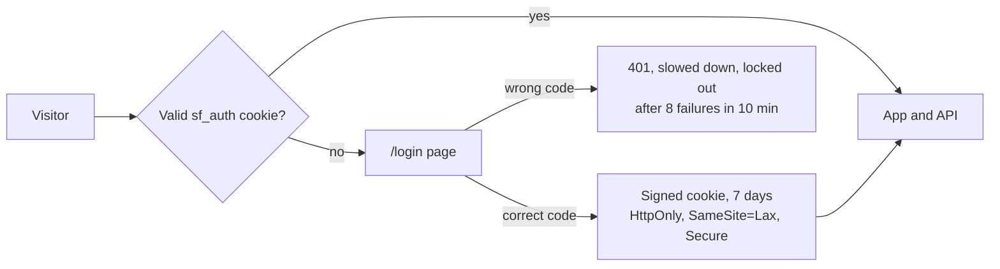

**How it works** (`app/lib/.server/auth.ts`):

- The code is compared in constant time. A correct code sets a cookie holding an expiry time and an HMAC-SHA256 signature made with `AUTH_SECRET`; the server recomputes and checks it on every request.
- Pages redirect to `/login?redirectTo=...` (only same-site paths are honoured); API calls get `401` JSON.
- **Fails closed in production:** if `ACCESS_CODE` or `AUTH_SECRET` is missing (or the secret is shorter than 16 characters), every page and API call returns `503`. Outside production, an unset `ACCESS_CODE` leaves the app open for local development.
- Sign out with the header button (`POST /logout`).

**Configure it on Vercel** (run these yourself; the values never go in the repo):

```bash
vercel env add ACCESS_CODE production                      # type the code you will share
openssl rand -hex 32 | vercel env add AUTH_SECRET production   # random signing secret
vercel --prod                                              # redeploy so the variables apply
```

**Limits to know:** it is one shared code, not per-user accounts, so you cannot tell users apart or revoke one person (change the code and secret to sign everyone out). The failed-attempt limit is stored in memory, so it is per serverless instance and not global. Anyone holding the code can use the API.

## Live Deployment

Deployed on Vercel: **https://siteforge-ai-opal.vercel.app** (production, Node.js 22). Screenshots from a real generation on the live URL (the prompt *"Create a modern restaurant website with a menu, gallery, reservations and location."*):

| Step | Screenshot |
|---|---|
| 1. Home |  |
| 2. Prompt entered | 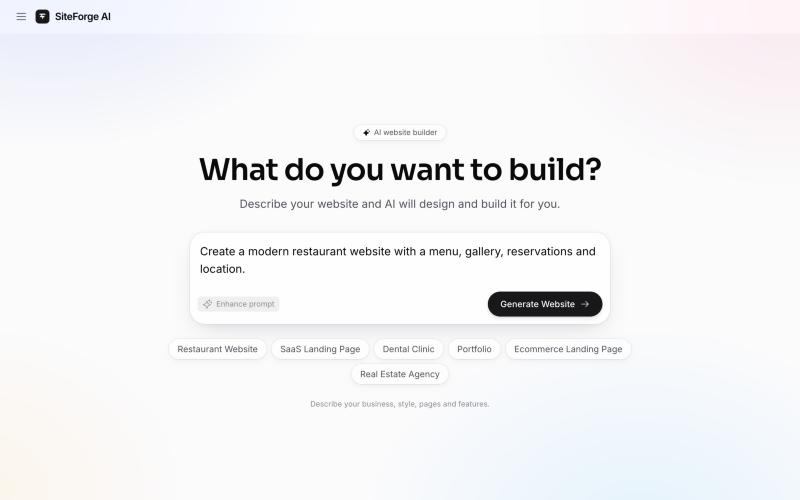 |
| 3. Generating: files appear as the model streams | 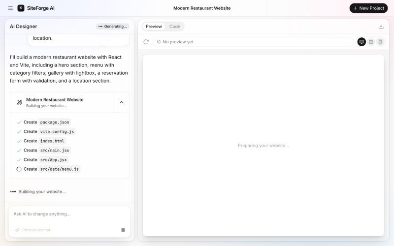 |
| 4. Complete, with the live preview running | 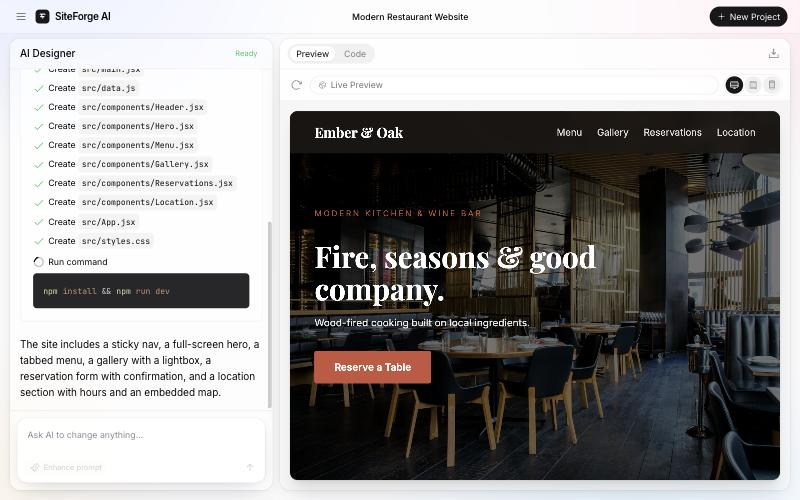 |
| 5. Generated site: menu and gallery | 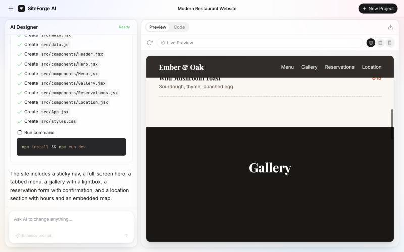 |
| 6. Generated site: reservations form | 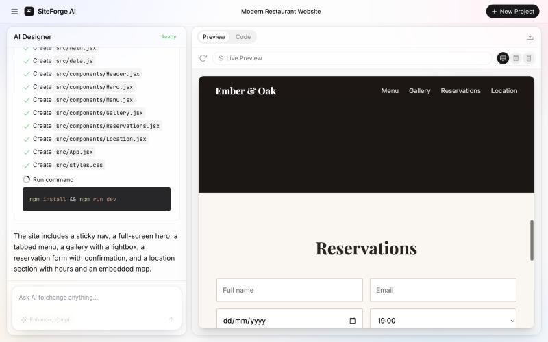 |

In the tested run the preview was running about 100 seconds after the prompt was submitted (one run, not repeated). The gallery section rendered as an empty dark block in the preview at the time of capture.

## Screenshots

A real run of the prompt *"Create a modern landing page for a dental clinic with services, doctors, testimonials and an appointment CTA."* The interface uses a light glassmorphism design: a white base with soft colour glows, frosted translucent panels, and black as the single accent colour.

| Step | Screenshot |
|---|---|
| 1. Home screen with example prompts | 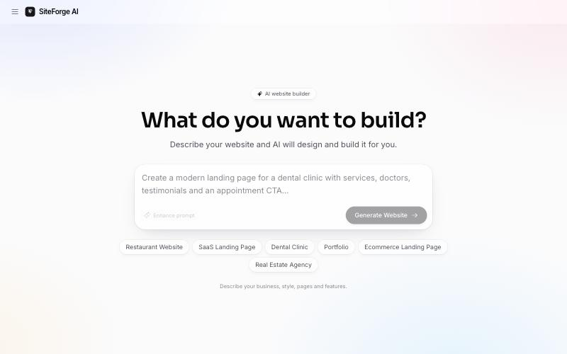 |
| 2. Prompt entered | 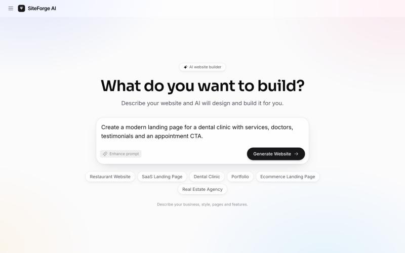 |
| 3. Generating (chat on the left, live preview on the right) | 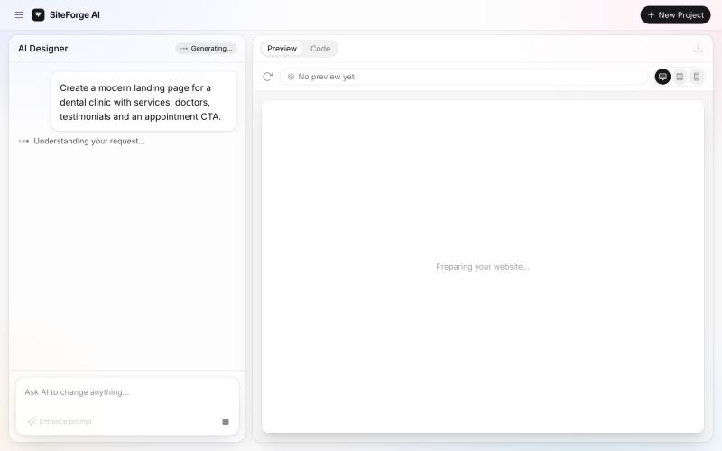 |
| 4. Generation complete | 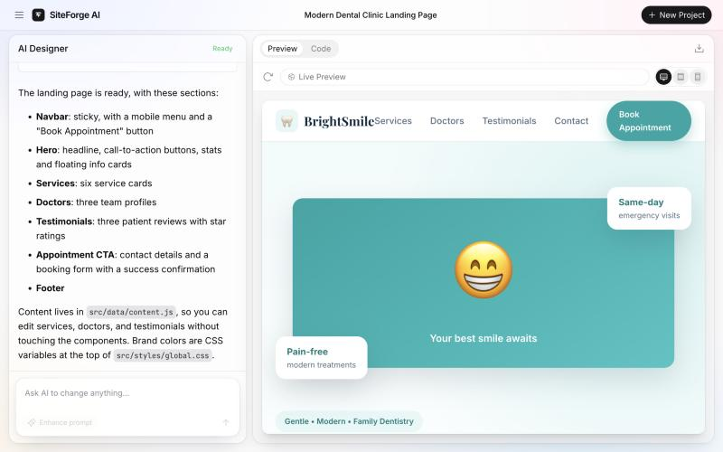 |
| 5. Generated website: hero | 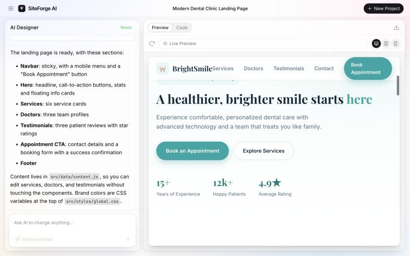 |
| 6. Generated website: services | 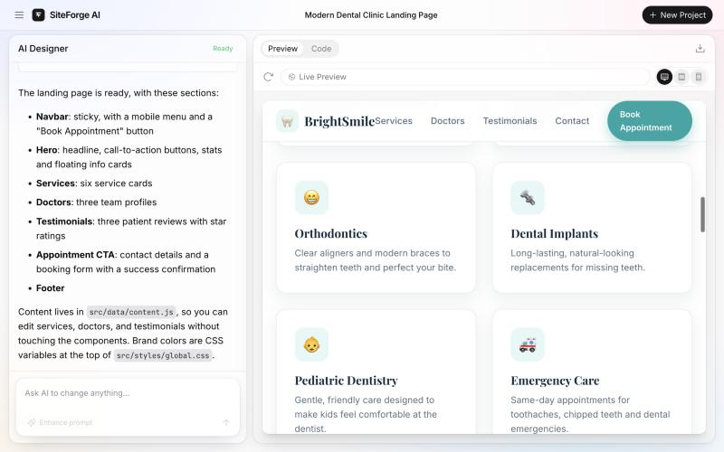 |
| 7. Generated website: doctors | 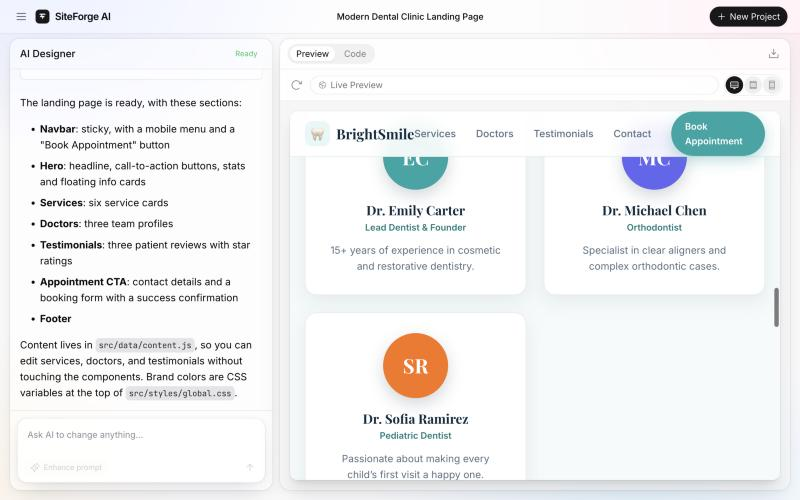 |
| 8. Mobile preview (390 px viewport) | 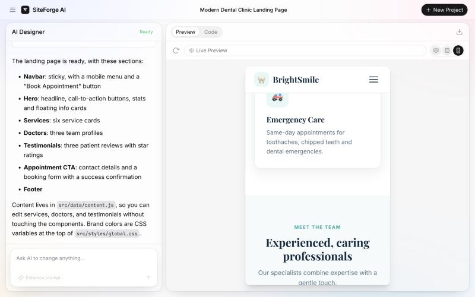 |
| 9. Code view | 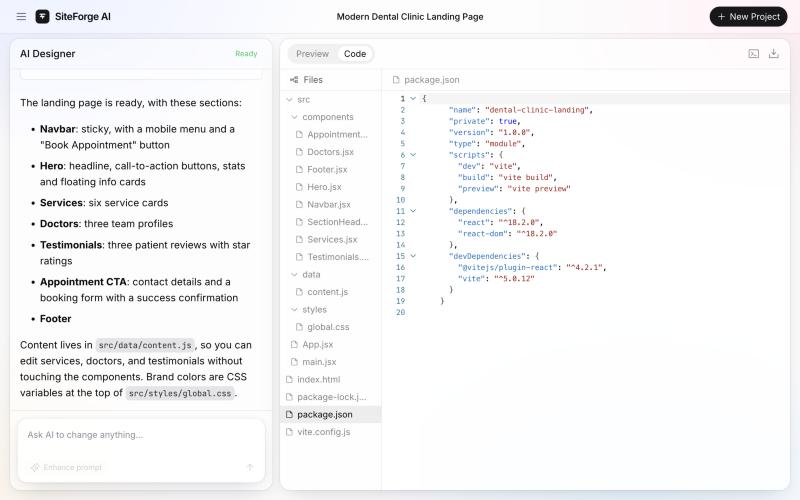 |
| 10. Projects drawer (frosted glass) | 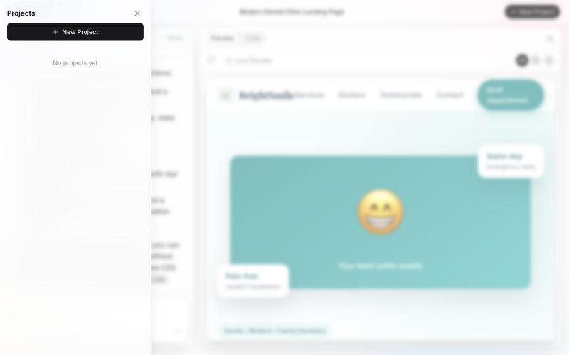 |

The earlier dark-theme screenshots are kept in [`screenshots/dark-ui-v1`](./screenshots/dark-ui-v1).

## Design System

- **Light theme only.** The theme is locked to light; the dark token block remains in `app/styles/variables.scss` but is not used.
- **Tokens, not hard-coded colours.** Colours come from the `--bolt-elements-`* variables in `app/styles/variables.scss`, so the look can be changed in one place.
- **Glass layer.** `.glass`, `.glass-strong`, `.glass-bar` and `.glass-pill` in `app/styles/index.scss` give frosted translucent surfaces (backdrop blur, a white inner highlight and a hairline edge) over a fixed soft-gradient page background.
- **Monochrome accent.** The `accent` palette in `uno.config.ts` is near-black, so primary buttons, the logo and active states are black on white.
- **Type.** Sora for headings, Inter for body text and JetBrains Mono for code.

## Demo Walkthrough

1. Start the app and confirm the model identifier works (send one short prompt first).
2. Click the **Dental Clinic** chip; show the files being written, the install step and the preview opening.
3. Switch the preview to mobile and tablet.
4. Ask: *"Make the hero more premium and add an FAQ section"*; show the preview update in place.
5. Open **Code**, edit a heading by hand, then send another refinement to show that the edit is kept.
6. Click **Download** and open the zip.
7. If the live demo fails, use a prepared screen recording of this same path, or the screenshots above.

## Acknowledgements & License

Built on the MIT-licensed [bolt.new](https://github.com/stackblitz/bolt.new) by StackBlitz; see [LICENSE](./LICENSE) for the original copyright notice and terms.
